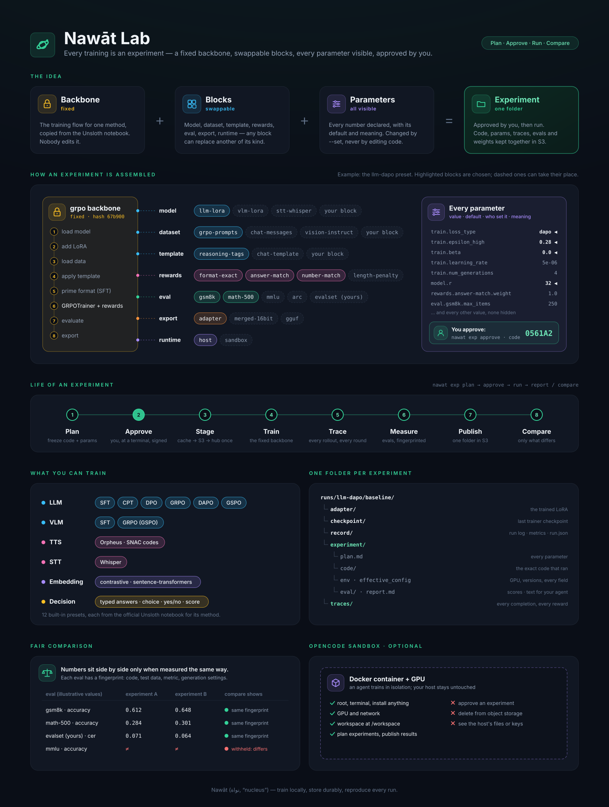

# The lab: experiments from blocks



The lab turns every training into an **experiment** assembled from parts that
are named, versioned and swappable, and keeps everything about it in one folder
that lives in object storage.

```text
experiment = backbone (fixed)  +  blocks (swappable)  +  parameters (all visible)
                                                        └─ approved by a person
```

- **Backbone** — the training flow for one method, copied step for step from the
  official Unsloth notebook: `sft`, `cpt`, `dpo`, `grpo`, `tts`, `stt`,
  `embedding`, `decision`. Nobody edits it. DAPO, GSPO and Dr. GRPO are `grpo`
  with different parameters, so they are presets, not code.
- **Blocks** — everything that changes from one experiment to the next:
  `model`, `dataset`, `template`, `rewards`, `eval`, `export`, `runtime`. Any
  block can be replaced by another block of the same kind.
- **Parameters** — every number a backbone or block uses is declared with its
  default and meaning. Nothing is hidden in the code. Values change with
  `--set`, never by editing code.
- **Preset** — a saved choice of backbone, blocks, inputs and values. A small
  TOML file.

**It is the only way to train.** There is no command that runs an arbitrary
training script; the executor underneath runs nothing but approved experiments
(each run of an experiment is one run in the run layer, with its log, metrics
and checkpoints); `nawat.begin_run()` refuses; and `runs/` in object storage
accepts only what experiments produce. So every recorded result — including any
an agent prepared — went through a fixed backbone, declared parameters and a
person's approval.

## The five commands

```bash
nawat preset show llm-grpo                       # every block and parameter, with defaults
nawat exp plan llm-grpo --set train.learning_rate=1e-5 --notes "lower lr"
nawat exp approve llm-grpo/20261102-ab12         # you, at a terminal: read the table, type the code
nawat exp run llm-grpo/20261102-ab12
nawat exp report llm-grpo/20261102-ab12          # plain text, for you or an agent
```

## What is built in

| Model type | Backbone | Preset | From the Unsloth notebook |
| --- | --- | --- | --- |
| LLM | `sft` | `llm-sft` | Qwen3 (14B) Reasoning-Conversational |
| LLM | `cpt` | `llm-cpt` | Mistral v0.3 (7B) CPT |
| LLM | `dpo` | `llm-dpo` | Zephyr (7B) DPO |
| LLM | `grpo` | `llm-grpo`, `llm-dapo`, `llm-gspo` | Qwen3 (4B) GRPO |
| VLM | `sft` | `vlm-sft` | Qwen3.5 (0.8B) Vision |
| VLM | `grpo` | `vlm-grpo` | Qwen3.5 (4B) Vision GRPO |
| TTS | `tts` | `tts-orpheus` | Orpheus (3B) TTS |
| STT | `stt` | `stt-whisper` | Whisper |
| Embedding | `embedding` | `embedding` | Qwen3-Embedding (0.6B) |
| Decision | `decision` | `decision` | Qwen3.5 (4B) Decision |

A *decision* model is a typed-answer model, the open alternative to hosted
decision APIs. It reads an input and answers declared questions with a `choice`
among named options, a `noul` yes/no, or a `score` on an ordered scale, with
calibrated probabilities.

`nawat block ls` lists every block. `nawat block show <kind>/<name>` explains
one and its parameters.

### GRPO, DAPO, GSPO

| Preset | `loss_type` | other differences |
| --- | --- | --- |
| `llm-grpo` | `grpo` | — |
| `llm-dapo` | `dapo` | `epsilon_high = 0.28` (clip-higher), `beta = 0` |
| `llm-gspo` | `dr_grpo` | `importance_sampling_level = "sequence"` |
| `vlm-grpo` | `dr_grpo` | sequence-level, the vision notebook's optimiser settings |

The Qwen3 GRPO notebook does not set `loss_type`, so TRL's default applies, and
in TRL 0.22 that default is `"dapo"`. Here it is always written down, so an
experiment called GRPO and one called DAPO cannot silently be the same thing.

`mask_truncated_completions` stays `false` in `llm-dapo` because Unsloth reports
KL/NaN problems with it on. TRL's own DAPO recipe sets it to `true`. It is one
`--set` away.

## Changing things without editing anything

Change a value for one experiment:

```bash
nawat exp plan llm-grpo --set train.num_generations=8 --set model.r=64
```

Keep the change as a preset:

```bash
nawat preset fork llm-grpo --as grpo-g8 --set train.num_generations=8
```

Swap a block:

```bash
nawat exp plan llm-grpo --use rewards=format-exact,answer-match,length-penalty
```

Parameter names are `<slot>.<name>`. The backbone's slot is called `train`. For
slots that hold several blocks (`rewards`, `eval`, `export`), name the block
too: `rewards.answer-match.weight`, `eval.gsm8k.max_items`.

Fields of the trainer config that a backbone does not declare can still be set,
visibly, through `train.extra`:

```bash
nawat exp plan llm-sft --set 'train.extra={"neftune_noise_alpha": 5}'
```

## Your own blocks

```bash
nawat block fork dataset/chat-messages --as my-data   # copy, then edit lab/blocks/dataset/my-data.py
nawat block new eval my-benchmark                     # start from the template for its kind
nawat preset fork llm-sft --as my-sft --use dataset=my-data --use eval=my-benchmark
```

Workspace blocks live in `<workspace>/lab/blocks/<kind>/<name>.py`. Each one is
a small Python file with `BLOCK`, `PARAMS` and the function its kind needs. The
templates in `nawat/lab/library/_templates/` show the shape.

**Blocks are never edited after use.** The first experiment that uses a
workspace block records its hash and makes the file read-only. If it is changed
later anyway, planning refuses. To keep the edit as a new block and restore the
original:

```bash
nawat block save-as dataset/my-data my-data-v2
```

Presets are never overwritten either. A fork records the preset it came from.

## Approval: the hard rule

`nawat exp plan` prints every parameter (marking the ones the preset or `--set`
changed) and a six-character code. The experiment does not start until someone
runs `nawat exp approve <name>` **at a terminal**, reads the table and types the
code.

- The code is the head of a hash over the frozen code, every parameter and the
  inputs. Changing anything after approval voids it.
- Approval refuses when there is no terminal, and always inside the sandbox.
- Approvals are signed with a key kept in Nawāt's state directory
  (`approval.key`), outside the workspace and never mounted into the sandbox. An
  `approval.json` written by anything else is refused at run time on the host
  and shows as `forged` in every report read there.
- The sandbox has no key, so it cannot check a signature. It refuses to start
  an experiment whose approval it cannot verify; a run in the sandbox is started
  from the host with `nawat exp run`, which verifies the signature and then
  launches the run inside the container.

This stops an agent from approving or starting its own plan in the normal course
of work, and makes any forgery visible on the host. It is not a security
boundary: an agent with root inside the sandbox could bypass the refusal there,
and a program running as your own user on the host could read the key the same
way `nawat` does. What neither can do is make a hand-written approval look
verified on the host.

## Everything an experiment produced, in one place

```text
<workspace>/lab/experiments/<group>/<name>/
    plan.md                 every parameter, default, meaning; library defaults too
    experiment.json         the frozen plan
    preset.toml             the effective preset — reusable as it is
    code/                   the exact backbone, blocks and helpers that run
    approval.json           who approved, signed
    attempts/<run>/         run log, metrics.jsonl, run record (one per attempt)
    env-<run>.json          GPU, driver, every library version, pip freeze
    effective_config-<run>.json   every trainer field actually in force
    train-<run>.json        trainer metrics and full log history
    traces/                 every rollout (GRPO) and probe sample
    eval/                   each eval's summary and per-item predictions
    report.md, report.json  the summary
```

The same folder, plus the model outputs, is in object storage:

```text
runs/<group>/<name>/adapter   merged   gguf   checkpoint   record   experiment   traces
```

Experiments are grouped by preset unless you pass `--group`, so the bucket
reads by line of research. `nawat exp pull <group>/<name>` brings an experiment
folder to another machine.

## Traces

GRPO and DAPO: every completion of every round is written to
`traces/rollouts-*.jsonl`, with the prompt, the completion, each reward, the
weighted total and its advantage inside its group. The trace is taken from the
reward functions themselves, so it is exactly what the trainer scored.

Other methods: every `train.sample_every` steps the model answers a fixed set of
probe inputs, written to `traces/samples-*.jsonl`.

```bash
nawat exp traces <exp>                          # per-step reward table
nawat exp traces <exp> --step 40                # every completion at step 40
nawat exp traces <A> <B> --step 40              # the same prompts, side by side
nawat exp traces <A> <B> --prompt "integral"    # find a prompt across steps
nawat exp traces <exp> --kind samples           # probe answers across training
nawat exp traces <exp> --clear                  # delete them, here and in storage
```

## Measuring: evals, and fair comparison

Eval blocks run after training:

| Block | Measures | Data |
| --- | --- | --- |
| `gsm8k` | grade-school maths, accuracy | `datasets/openai/gsm8k` |
| `math-500` | competition maths, accuracy | `datasets/HuggingFaceH4/MATH-500` |
| `mmlu` | 57 subjects, log-likelihood accuracy | `datasets/cais/mmlu` |
| `arc-challenge` | science questions, acc / acc_norm | `datasets/allenai/ai2_arc` |
| `truthfulqa-mc1` | truthfulness, log-likelihood accuracy | `datasets/truthfulqa/truthful_qa` |
| `evalset` | **your own test set** with a metric you choose | any `datasets/...` key |
| `heldout-generate` | held-out training data: exact / number / CER / WER | the training dataset |
| `heldout-loss` | held-out loss and perplexity | the training dataset |
| `embedding-retrieval` | recall@k, MRR | the training dataset |
| `decision-holdout`, `decision-test` | decision accuracy and calibration | the training dataset |

Benchmark data is an input of the experiment. The first time it is used, Nawāt
fetches it from Hugging Face and writes it to object storage. After that it
comes from there.

Your own eval set: write JSONL (`{"prompt": ..., "reference": ...}` per line),
publish it, and point `evalset` at it:

```bash
nawat publish ./my-evals datasets/my-evals/ocr-v1
nawat exp plan vlm-sft --use eval=heldout-generate,evalset \
    --set eval.evalset.dataset=datasets/my-evals/ocr-v1 --set eval.evalset.metric=cer
```

**Every eval has a fingerprint**, a hash of its code, test data, metric and
generation settings (and, for held-out evals, the training data split). `nawat
exp compare` puts eval numbers side by side only when the fingerprints match. If
two experiments were measured differently, compare says so and withholds those
numbers, unless `--force` shows them marked ⚠.

## Comparing and sweeping

```bash
nawat exp compare A B C            # only what differs, beside the results
nawat exp report --compare A B C   # one text for an agent: shared setup, differences, results
```

```bash
nawat sweep plan llm-grpo --model models/unsloth/Qwen3-4B-Base,models/unsloth/Qwen3-1.7B-Base \
    --vary train.learning_rate=1e-6,5e-6
nawat exp approve <sweep-id>       # one approval for the whole grid
nawat sweep run <sweep-id>         # one after another (or --queue: all queued, and return)
```

## One GPU: the queue

Runs take turns on the GPU, whichever way they were started: a run holds the
GPU from staging to its last upload, and the next one starts when it is done,
in the order they were submitted. Runs in the sandbox take turns with runs on
the host. A run that is waiting is `queued`.

```bash
nawat exp run A                    # GPU busy: waits here, streaming "waiting for run … — 1 ahead", then runs
nawat exp run B --queue            # queue it and return; it runs without this terminal
nawat exp approve C --queue        # approve and queue in one step (a sweep id queues every experiment)
nawat exp queue                    # what is on the GPU, what waits, in order, with estimated start times
nawat exp cancel B                 # take a queued run out of the queue (or stop a running one)
```

Ctrl-C while `nawat exp run` waits takes the run out of the queue. A run queued
with `--queue` does not need `nawat api`: when the control plane is not running,
a small worker (`nawat exp queue --work`, started for you, logging to
`<state_dir>/queue-worker.log`) runs the queued runs one after another and stops
when none are left. An experiment can have only one attempt queued or running
at a time.

## Controlling object storage

```bash
nawat store ls                     # top level, with sizes
nawat store ls runs/llm-grpo       # deeper
nawat exp du <exp>                 # one experiment, part by part
nawat exp rm <exp> --parts merged gguf --remote    # keep the adapter, drop the big exports
nawat exp rm <exp> --parts all                     # everything, here and in storage
nawat store rm datasets/old-corpus                 # anything, by prefix
nawat store get runs/llm-grpo/x/adapter ./adapter  # download
```

Deleting asks for confirmation (or `--yes`), refuses anything a live run is
using, refuses prefixes broader than `<kind>/<name>`, and is not allowed inside
the sandbox.

## The OpenCode sandbox

An isolated container for an agent ([OpenCode](https://opencode.ai/)) that
trains models:

- root, a terminal and the network inside, so it can install anything;
- the GPU;
- the workspace mounted at `/workspace`, and nothing else of the host;
- its own cache, plus the object-store credentials, so what it trains is
  published to the same bucket.

It cannot approve experiments, cannot start one on its own (the host checks the
approval, then launches the run inside it), and cannot delete from object
storage.

```bash
nawat sandbox build          # once: CUDA 12.8 image + training stack + Nawāt + OpenCode
nawat sandbox up             # start it (writes AGENTS.md into the workspace if missing)
nawat sandbox opencode       # OpenCode inside it
nawat sandbox shell          # a shell inside it
nawat sandbox down
```

It needs Docker and the NVIDIA Container Toolkit on the host.

It is optional, like every block. An experiment runs inside it only when its
runtime block is `sandbox`; approving and starting it stay on the host:

```bash
nawat exp plan llm-grpo --use runtime=sandbox     # here, or by the agent inside
nawat exp approve llm-grpo/<name>                 # on the host
nawat exp run llm-grpo/<name>                     # on the host: checks the approval, runs it in the sandbox
nawat exp logs llm-grpo/<name> -f                 # from either side
```

`nawat sandbox agents` prints the rules the agent is given. They are useful for a
local agent outside the sandbox too.
